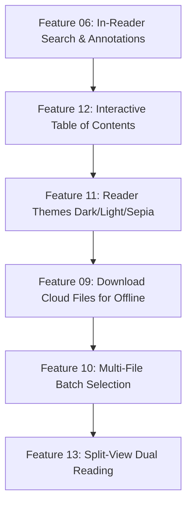

# Multi-File Reader — Expected Features & Product Roadmap

This document outlines the **completed features**, **in-progress foundations**, and **new expected features** planned for both the **Web Application** and **Electron Desktop Application**.

---

## 📊 Feature Status Overview

| ID | Feature Name | Platform | Status |
| :--- | :--- | :--- | :--- |
| **01** | **Local File Reading in Desktop Library** | Desktop (Electron) | ✅ Implemented |
| **02** | **Native Cover & Page Previews for Local Files** | Desktop (Electron) | ✅ Implemented |
| **03** | **DaVinci Resolve-Style Media Offline & Relink** | Desktop & Web | ✅ Implemented |
| **04** | **Guest / Offline Mode (No Login) & Local Bookmarking** | Desktop & Web | ✅ Implemented |
| **05** | **Legacy Reader Route Redirection** | Desktop & Web | ✅ Implemented |
| **06** | **In-Reader Search & Annotations / Highlights** | Desktop & Web | ⏳ Foundation Ready (Next Up) |
| **07** | **Session Restore on Launch & Resume Reading** | Desktop & Web | ✅ Implemented |
| **08** | **Cloud vs. Local Storage Visual Indicators** | Desktop & Web | ✅ Implemented |
| **09** | **Download Cloud Files for Offline Reading** | Desktop & Web | 📋 Planned |
| **10** | **Multi-File Batch Selection & Library Actions** | Desktop & Web | 📋 Planned |
| **11** | **Reader Display Themes (Dark, Light, Sepia Eye-Care)** | Desktop & Web | 📋 Planned |
| **12** | **Interactive Table of Contents (TOC) & Chapter Navigation** | Desktop & Web | 📋 Planned |
| **13** | **Side-by-Side Dual Document Split-View** | Desktop & Web | 💡 Proposed |
| **14** | **Reading Statistics, Velocity & Time Estimates** | Desktop & Web | 💡 Proposed |

---

## 🚀 Recently Implemented Features (Completed)

### Feature 01: Local File Reading in Desktop Library
- Native OS file picker dialog integration via Electron IPC (`dialog.showOpenDialog`).
- Supports `.pdf`, `.epub`, and `.txt` files directly from disk without upload bandwidth limits.
- Persists local files to library database (if authenticated) and to local library store (`mfr_local_library`) for offline usage.

### Feature 02: Native Cover & Page Previews for Local Files
- Direct cover extraction for local files bypassing backend `/proxy`.
- Custom protocol `mfr-local://` safely streams byte ranges from local disk.
- PDF page rendering via `PDF.js` canvas thumbnail generation; EPUB cover image extraction from archive manifest.

### Feature 03: DaVinci Resolve-Style "Media Offline" & Relinking
- Background validation checks if active or library files still exist at their original disk path.
- Renders cinematic red hazard striping overlay and warning modal if a file was moved, renamed, or deleted on disk.
- One-click **"Relink Media..."** dialog to locate the moved file; automatically migrates library paths, reading bookmarks, active tabs, and annotations.

### Feature 04: Guest / Offline Mode & Local Bookmarking
- Fully decoupled bookmarking from mandatory JWT authentication.
- Offline-first storage (`mfr_local_bookmarks`) immediately saves current page, EPUB CFI, and percentage progress.
- Asynchronously syncs with backend PostgreSQL database whenever user token is present.

### Feature 05: Legacy Reader Route Redirection
- Legacy single-file reader routes (`/reader/pdfreader?url=...` and `/reader/epubreader?url=...`) automatically redirect to `/reader?files=...&active=0`.
- Unifies user navigation under the tabbed reader layout.

### Feature 07: Session Restore on Launch & Resume Reading
- Reader tabs and active tab index automatically persist to `mfr_last_reader_session`.
- Opening `/reader` without parameters automatically restores the last reading session.
- Library dashboard displays a **"Resume Reading (N)"** button in the header action bar for 1-click continuation.

### Feature 08: Cloud vs. Local Storage Indicators & Filtering
- **Library Cards:** Top-right glassmorphic pill badge (☁️ **Cloud** in sky-blue vs. 💾 **Local** in emerald green) and metadata source label.
- **Library Filter:** Added **"Source"** dropdown (`All Sources`, `Cloud Storage`, `Local Disk`) to filter the library grid.
- **Reader Tabs:** Storage badge displayed next to the file format tag on every open tab.
- **Reader Top Bar:** Active file header displays storage source beside document format.

---

## 🔮 Expected New Features (Roadmap & Detailed Specs)

### 📌 Feature 06: In-Reader Search & Annotations / Highlights (High Priority)
*Architecture foundation already implemented in `localAnnotations.ts` and `UnifiedReaderLayout.tsx`.*
- **Document Text Search:**
  - Search overlay toggleable via `Ctrl+F` / `Cmd+F` or header icon.
  - PDF: Uses `PDFFindController` / text layer matching.
  - EPUB: Uses `book.find()` to query chapters asynchronously.
  - Match count indicator (`3 of 28 matches`), match highlighting, and Next/Previous navigation buttons.
- **Highlighting & Color Customization:**
  - Text selection menu to highlight passages in 4 colors: Yellow (`#fef08a`), Green (`#bbf7d0`), Blue (`#bae6fd`), and Pink (`#fbcfe8`).
- **Notes & Comments:**
  - Ability to attach a text note to any highlight.
- **Annotations Drawer:**
  - Collapsible sidebar tab to view all highlights, notes, and bookmarks for the active document.
  - Clicking any annotation instantly navigates the reader to that exact page number or EPUB CFI.

---

### 📌 Feature 09: Download Cloud Files for Offline Reading
- **Offline Sync Button:**
  - On cloud file cards, add a **"Save for Offline"** action in Electron desktop mode.
- **Local Cache Storage:**
  - Streams file from Google Cloud Storage / backend into application data directory (`userData/offline_files/`).
  - Registers the downloaded file as an offline local file so it opens with zero network latency.
- **Sync Status Badge:**
  - Displays a "Downloaded" checkmark icon on the file card.

---

### 📌 Feature 10: Multi-File Batch Selection & Library Actions
- **Selection Mode:**
  - Checkboxes on library file cards to select multiple items.
  - Bulk action toolbar appearing when 1 or more files are selected.
- **Actions Available:**
  - **"Open Selected in Tabs"**: Opens all selected books into the unified reader simultaneously.
  - **"Batch Delete"**: Deletes multiple selected files with single confirmation.
  - **"Batch Relink"**: Folder scanner to automatically relink multiple offline files located in the same parent directory.

---

### 📌 Feature 11: Reader Display Themes (Eye-Care & Accessibility)
- **Three Core Color Themes:**
  1. **Dark (Default)**: Deep charcoal background (`#0e1015`), soft white text, high contrast.
  2. **Light**: Crisp paper white background (`#ffffff`), dark graphite typography.
  3. **Sepia (Eye-Care)**: Warm parchment background (`#fbf0d9` / `#f4ecd8`), warm espresso typography (`#382b20`) for long-session eye strain reduction.
- **Customizable Font Family:**
  - Choice between Modern Sans (Inter), Editorial Serif (Merriweather / Georgia), and Monospace.
- **Line Spacing & Margins:**
  - Slider controls for line height (1.4x - 2.0x) and page margin padding.

---

### 📌 Feature 12: Interactive Table of Contents (TOC) & Chapter Navigation
- **EPUB TOC Integration:**
  - Read navigation tree (`book.loaded.navigation`) into sidebar drawer.
  - Multi-level nested chapter hierarchy with expand/collapse.
- **PDF Outlines & Bookmarks:**
  - Extract PDF document outline items via `pdfjs.getOutline()`.
- **Active Chapter Tracker:**
  - Highlights currently reading chapter based on current reading progress.

---

### 📌 Feature 13: Side-by-Side Dual Document Split-View
- **Comparative Reading:**
  - Split reader canvas vertically into Left Pane and Right Pane.
  - Allows reading a reference text / original manuscript on the left while reading translations or notes on the right.
- **Independent Navigation:**
  - Separate scroll and page controls for each pane.

---

### 📌 Feature 14: Reading Analytics & Progress Insights
- **Reading Speed & Velocity:**
  - Real-time Words Per Minute (WPM) calculation.
- **Time to Finish:**
  - Dynamic estimated time remaining for current chapter and total book.
- **Daily Reading Streak & Minutes:**
  - Personal reading log tracking daily minutes read.

---

## 🛠️ Recommended Implementation Sequence

